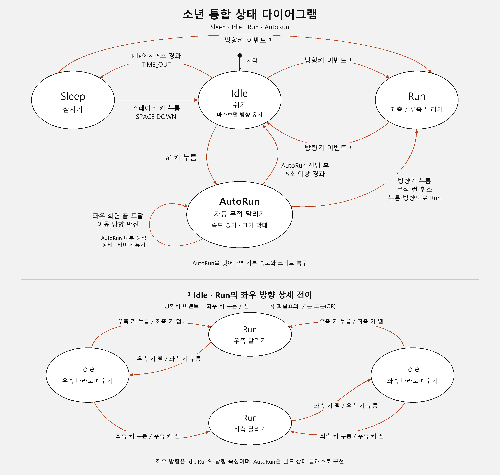

# PRD — Drill11 소년 자동 무적 런

| 항목 | 내용 |
| --- | --- |
| 문서 버전 | 1.0 |
| 작성일 | 2026-10-28, Asia/Seoul |
| 대상 | Windows에서 실행하는 Pico2D 캐릭터 상태 전이 실습 |
| 제품명 | Drill11 — AutoRun |
| 기준 | 제공된 Drill #11 과제 이미지, 통합 상태 다이어그램, 현재 구현 |
| 저장소 | https://github.com/adg6641/Drill11 |

이 문서는 만들어진 게임의 동작을 기준으로 개발 목적, 범위, 구현 요구사항과 인수 기준을 정리한 문서입니다.
이번 커밋 이력은 기존 완성본의 변경 내용을 기능 단위로 다시 구성한 기록입니다. 과거 작업 시각을 재현하거나 커밋 날짜를 변경하지 않습니다.

## 1. 개발 배경과 목적

기존 소년은 키 입력에 따라 쉬기, 달리기, 잠자기 상태를 전환합니다. 여기에 제한 시간 동안 자동으로 빠르게 달리는 AutoRun을 추가합니다.
사용자는 Idle에서 `a`를 한 번 눌러 자동 이동을 시작하고, 방향키로 이를 취소해 일반 조작으로 돌아올 수 있어야 합니다.

학습 목표는 다음과 같습니다.

1. 기존 상태 전이 구조에 별도 상태 클래스를 추가합니다.
2. 상태 진입·유지·종료의 책임을 나눕니다.
3. 시간, 방향, 속도, 크기, 입력 상태를 일관되게 관리합니다.
4. 상태 다이어그램, 구현 코드, 실행 결과가 서로 일치하도록 검증합니다.

## 2. 사용자와 사용 시나리오

- 학습자는 VS Code 또는 터미널에서 게임을 실행하고 키로 소년을 조작합니다.
- 채점자는 `a` 진입, 5초 종료, 속도·크기 변화, 양쪽 끝 반전, 제출 다이어그램을 확인합니다.
- 유지보수자는 PRD의 요구사항 ID와 테스트를 통해 변경 영향을 확인합니다.

대표 시나리오:

1. 게임을 시작하면 소년이 화면 중앙의 Idle 상태로 등장합니다.
2. `a`를 누르면 바라보던 방향으로 빠르게 자동 이동하고 커진 모습으로 달립니다.
3. 좌우 끝에 도달하면 방향을 바꾸며 계속 달립니다.
4. 5초 이상 경과하면 Idle로 돌아오고 기본 속도와 크기를 회복합니다.
5. 제한 시간이 지나기 전에 방향키를 누르면 AutoRun이 즉시 취소되고 누른 방향으로 일반 Run을 수행합니다.

## 3. 개발 범위

### 포함 범위

- 800×600 창과 기존 잔디 배경·소년 스프라이트.
- Idle, Run, Sleep 유지 및 AutoRun 클래스 추가.
- 좌우 방향키의 누름·해제·동시 입력 처리.
- 실제 경과 시간에 따른 대기·자동 달리기 제한 시간.
- AutoRun의 자동 이동, 속도·크기 변화, 화면 경계 반사, 입력 취소.
- PNG·SVG 통합 상태 다이어그램, 실행 안내, 요구사항 및 검증 문서.
- 단위 테스트, 실제 SDL 이벤트·렌더링 검증, 기능별 Git 커밋과 공개 업로드.

### 제외 범위

- 적, 충돌 피해, 점수, 승패, 추가 스테이지, 네트워크 기능.
- 별도의 시작 메뉴, 설정 화면, 사운드, 실행 파일 패키징.
- 기존 에셋의 새 디자인 또는 교체.
- 수업 디스코드 공지에서 요구하는 별도 제출 행위.

현재 장면에는 피격 기능이 없습니다. 무적 여부는 `is_invulnerable` 상태 값으로 표현하며, 실제 피해 무효화 시스템이 구현되어 있다고 주장하지 않습니다.

## 4. 화면과 조작 기획

화면 하단의 잔디 위에서 소년이 좌우로 이동합니다. 기존 실습 화면과 같은 구성을 사용하고 상태에 따라 자세, 방향, 크기를 바꿉니다.

| 항목 | 설계 값 |
| --- | --- |
| 화면 크기 | 800×600 px |
| 최초 위치 | x=400, y=85 |
| 최초 상태·방향 | Idle, 우측(+1) |
| 기본 이동 속도 | 250 px/s |
| AutoRun 이동 속도 | 500 px/s, 기본의 2배 |
| 기본 스프라이트 표시 크기 | 100×100 px |
| AutoRun 표시 크기 | 160×160 px, 기본의 1.6배 |
| 기본 애니메이션 | 8프레임, 초당 10프레임 |
| AutoRun 애니메이션 | 이동 속도 비율에 따라 초당 20프레임 |
| 목표 루프 주기 | 약 60 FPS. 이동량은 실제 프레임 경과 시간으로 계산 |

| 입력 | 유효 상태 | 동작 |
| --- | --- | --- |
| `←` / `→` 누름 | Idle·Run·Sleep | 유효 방향에 따른 일반 이동 상태 결정 |
| `←` / `→` 해제 | 일반 조작 중 | 남은 키에 따라 Run 또는 Idle 결정 |
| `a` 누름 | Idle | AutoRun 시작 |
| `a` 누름 | Run·Sleep·AutoRun | 상태 변경 없이 무시 |
| 방향키 누름 | AutoRun | AutoRun 취소 후 누른 방향의 Run |
| 방향키 해제 | AutoRun | 자동 이동 유지 |
| `Space` 누름 | Sleep | Idle로 복귀 |
| `Esc` / 창 닫기 | 전체 | 게임 종료 |

## 5. 기능 요구사항

우선순위 `필수`는 제공된 과제 기준 또는 기존 상태 동작을 충족하는 기능, `품질`은 안정적인 실행과 확인을 지원하는 기능입니다.

| ID | 우선순위 | 요구사항 | 인수 기준 |
| --- | --- | --- | --- |
| FR-01 | 필수 | 초기 Idle 상태를 제공한다. | 실행 직후 x=400, y=85, 우측을 바라보며 Idle이다. |
| FR-02 | 필수 | 좌우 일반 달리기를 제공한다. | 한 방향키를 누르면 해당 방향의 Run, 마지막 키를 놓으면 바라보던 방향의 Idle이다. |
| FR-03 | 필수 | 동시 방향 입력을 처리한다. | 좌우를 모두 누르면 Idle, 한쪽을 놓으면 남은 방향의 Run이다. |
| FR-04 | 필수 | Idle 대기 후 Sleep으로 전이한다. | Idle 진입 후 4.999초에는 유지하고 5.000초 이상이면 Sleep이다. |
| FR-05 | 필수 | Sleep에서 깨울 수 있다. | Space는 Idle, 방향키는 해당 방향의 Run으로 전이한다. Idle 복귀 시 대기 타이머를 다시 시작한다. |
| FR-06 | 필수 | 별도 AutoRun 클래스를 둔다. | `boy.py`에 `class AutoRun(BoyState)`가 있고 상태 머신의 AUTORUN과 연결된다. |
| FR-07 | 필수 | Idle에서 `a`로 AutoRun을 시작한다. | Idle에서 한 번 누르면 진입한다. 다른 상태의 `a` 입력은 무시한다. |
| FR-08 | 필수 | 추가 입력 없이 자동 이동한다. | 진입 시 바라보던 방향으로 이동하며 `is_invulnerable=True`이다. 이전 방향키 기록은 비운다. |
| FR-09 | 필수 | AutoRun을 5초로 제한한다. | 진입 후 4.999초에는 유지하고 5.000초 이상이면 다음 업데이트에서 Idle로 전이한다. |
| FR-10 | 필수 | AutoRun 속도를 높인다. | 동일 시간 이동량이 기본보다 크고 설정 속도는 500 px/s이다. |
| FR-11 | 필수 | AutoRun 크기를 확대한다. | 실제 그리기 함수가 160×160 크기를 사용하며 발의 지면 높이를 보정한다. |
| FR-12 | 필수 | 좌우 화면 끝에서 방향을 반전한다. | 확대 상태의 중심 x가 80~720 안에 있고 양쪽 끝에서 반전한다. 초과 이동량도 반사 처리한다. |
| FR-13 | 필수 | 반전 시 제한 시간을 유지한다. | 경계 반전은 내부 동작이며 상태 재진입이나 시작 시각 변경을 일으키지 않는다. |
| FR-14 | 필수 | 방향키로 AutoRun을 취소한다. | 좌우 키 누름 각각 해당 방향의 일반 Run으로 전이한다. 키 해제는 취소를 일으키지 않는다. |
| FR-15 | 필수 | AutoRun 종료 시 기본값을 복구한다. | 시간 종료와 방향키 취소 모두 speed=250, scale=1, is_invulnerable=False이다. |
| FR-16 | 품질 | 반복 키 입력을 무시한다. | 운영체제 키 반복으로 상태가 흔들리거나 AutoRun 타이머가 연장되지 않는다. |
| FR-17 | 필수 | 상태 다이어그램을 제출물에 포함한다. | 저장소 루트에 PNG·SVG가 있으며 네 상태와 좌우 방향 전이를 표시한다. |
| FR-18 | 품질 | 게임을 정상 종료한다. | Esc·창 닫기로 루프가 종료되고 캔버스가 정리된다. |

## 6. 상태 설계

클래스명은 `Idle`, `Run`, `Sleep`, `AutoRun`이고 상태 머신의 상태 값은 `IDLE`, `RUN`, `SLEEP`, `AUTORUN`입니다.
좌우 방향은 별도 클래스가 아닌 `face_dir` 값으로 관리합니다. `+1`은 우측, `-1`은 좌측입니다.

| 현재 상태 | 이벤트·조건 | 다음 상태 | 주요 처리 |
| --- | --- | --- | --- |
| 시작 | 객체 생성 | Idle | 우측 방향, 기본 크기·속도, 대기 타이머 시작 |
| Idle | 유효 방향키 입력 | Run | 방향 갱신, 달리기 애니메이션 |
| Run | 유효 방향 합이 0 | Idle | 마지막 방향 유지, 대기 타이머 시작 |
| Idle | 5초 경과 | Sleep | 누운 자세 표시 |
| Sleep | Space 누름 | Idle | 대기 타이머 재시작 |
| Sleep | 유효 방향키 입력 | Run | 입력 방향으로 이동 |
| Idle | `a` 누름 | AutoRun | 자동 이동 시작 시각 기록, 이전 키 기록 초기화, 무적·속도·크기 적용 |
| AutoRun | 화면 끝 도달 | AutoRun 유지 | 이동 방향만 반전, 초과 이동량 반사 |
| AutoRun | 진입 후 5초 이상 | Idle | AutoRun 기본값 복구, Idle 대기 시작 |
| AutoRun | 방향키 누름 | Run | AutoRun 기본값 복구, 새 키 방향으로 이동 |

AutoRun 업데이트에서는 시간 종료를 이동보다 먼저 검사합니다. 같은 업데이트에서 제한 시간에 도달하면 추가 자동 이동 없이 Idle로 전이합니다.
Idle의 대기 시간과 AutoRun의 지속 시간은 각각 `idle_started_at`, `auto_run_started_at`으로 분리합니다.



[SVG 원본](state_diagram.svg)

## 7. 기술·구조 설계

| 파일·구성 | 책임 |
| --- | --- |
| `boy.py` | 상태 클래스, 전이, 키 상태, 이동·경계·애니메이션·크기 처리 |
| `main.py` | SDL 이벤트 분배, 객체 생성, 업데이트·렌더링 루프, 종료 |
| `grass.py` | 기존 잔디 이미지 로딩과 그리기 |
| `animation_sheet.png` | 현재 소년의 Idle·Run·Sleep·AutoRun 표시 원본 |
| `grass.png` | 현재 배경에 사용하는 잔디 |
| `run_animation.png` | 원본 프로젝트에 포함된 에셋. 현재 코드에서 별도 로딩하지 않음 |
| `requirements.txt` | Pico2D 1.5.1, transitions 0.9.3 |
| `.vscode/launch.json` | VS Code의 Run Drill11 실행 구성 |
| `tests/test_boy.py` | 상태·시간·방향·크기·속도·경계 단위 검증 |
| `tests/test_events.py` | 이벤트 분배·키 반복·종료 검증 |
| `tests/runtime_smoke.py` | 실제 창, 이미지, SDL 이벤트 큐, 실제 시간 검증 |

## 8. 비기능 요구사항

| ID | 요구사항 | 확인 방법 |
| --- | --- | --- |
| NFR-01 | 실행 작업 디렉터리에 의존하지 않고 에셋을 찾는다. | 소스 파일 기준 경로 사용, 폴더 밖에서 main.py 실행 |
| NFR-02 | 이동 거리가 프레임 횟수에 의존하지 않는다. | 같은 시간에 대한 1회·10회 업데이트 거리 비교 |
| NFR-03 | 느린 프레임에도 확대된 소년이 화면 밖에 남지 않는다. | 한 프레임에서 여러 번 반사되는 조건 검증 |
| NFR-04 | main.py를 import하는 것만으로 창이 열리지 않는다. | 메인 진입점 보호, 이벤트 단위 테스트에서 import |
| NFR-05 | 검증 결과를 재현할 수 있다. | 의존성 버전·명령·검증 결과 문서 제공 |
| NFR-06 | Git에 실행 캐시나 인증 정보를 포함하지 않는다. | .gitignore와 추적 파일 목록 확인 |

## 9. 채점 항목과 추적성

아래 배점은 제공된 과제 이미지에 표시된 항목을 옮긴 것이며, 실제 점수는 담당 채점자의 판단에 따릅니다.

| 과제 항목 | 배점 | 요구사항 | 구현·검증 |
| --- | --- | --- | --- |
| `a`로 AutoRun 전이 | 1점 | FR-06~08 | `request_auto_run`, SDL a 이벤트, 별도 클래스 확인 |
| 5초 후 Idle 복귀 | 1점 | FR-09, FR-15 | 4.999/5.000초 단위 테스트, 실제 경과 시간 측정 |
| 속도 증가·크기 확대 | 1점 | FR-10~11 | 이동량 비교, 실제 그리기 크기·복구 확인 |
| 양쪽 끝 자동 반전 | 1점 | FR-12~13 | 좌·우·정확한 경계·다중 반사·타이머 유지 테스트 |
| 상태 다이어그램 | 1점 | FR-17 | 저장소 PNG·SVG와 상태 전이 표 대조 |

추가 동작인 방향키 취소(FR-14), 기존 Sleep 동작(FR-04~05), 동시 입력(FR-03)도 회귀 검증 대상입니다.

## 10. 인수 테스트와 완료 조건

```powershell
python -m pip install -r requirements.txt
python -m unittest discover -s tests -v
python tests/runtime_smoke.py
python main.py
```

완료 조건:

1. 단위·이벤트 테스트 22개가 모두 통과합니다.
2. 실제 SDL 검증에서 좌우 자동 반전과 5초 종료, 두 방향 취소, Sleep·깨우기가 모두 통과합니다.
3. 코드·다이어그램·README·PRD의 상태와 수치가 일치합니다.
4. PRD와 다이어그램이 Drill11 루트에 포함됩니다.
5. 기능 단위로 10개 이상의 내용 있는 커밋을 구성하고 GitHub 공개 main과 로컬 main이 일치합니다.

실시간 검증의 종료 관측값에는 업데이트 한 프레임 내외의 오차가 있을 수 있습니다. 프로그램의 판정 조건은 경과 시간 `>= 5.0`입니다.

## 11. 개발 단계와 이력 관리

| 단계 | 내용 |
| --- | --- |
| 1 | 기존 프로젝트·에셋 기준선 보관 |
| 2 | 개발 목적·요구사항·인수 기준 문서화 |
| 3 | Idle·Run·Sleep 클래스와 표시 책임 분리 |
| 4 | 경과 시간 기반 이동·애니메이션 |
| 5 | 동시 방향키·해제 전이 정리 |
| 6 | 실행 진입점·루프·정상 종료 정리 |
| 7 | AutoRun 클래스와 a 키 자동 이동 |
| 8 | AutoRun의 5초 제한과 Idle 복귀 |
| 9 | 방향키 누름으로 취소 |
| 10 | 자동 달리기 속도 증가·복구 |
| 11 | 소년 크기 확대·복구·발 위치 보정 |
| 12 | 양쪽 경계 반사와 타이머 유지 |
| 13 | 상태·이벤트 단위 테스트 |
| 14 | 실제 SDL 실행 검증 코드 |
| 15 | 통합 상태 다이어그램 |
| 16 | 실행 환경·VS Code·README 정리 |
| 17 | 최종 인수 결과와 검증 기록 확정 |

각 단계는 실제 파일 변경을 포함합니다. 기존 이력은 교체 전에 저장소 밖의 Git bundle로 백업합니다.
공개 main 교체에는 예상 원격 커밋을 지정한 `--force-with-lease`를 사용해 작업 중 다른 변경이 생기면 중단되도록 합니다.

## 12. 제약과 후속 검토

- Windows·Python 3.13과 현재 의존성에서 검증합니다. 다른 운영체제나 버전의 호환성을 검증했다고 주장하지 않습니다.
- 피해·충돌 시스템을 나중에 추가한다면 `is_invulnerable`을 피해 처리 조건에 연결하는 별도 요구사항이 필요합니다.
- VS Code 디버그 실행에는 Python·Python Debugger 확장이 필요합니다. 터미널의 `python main.py`도 실행 경로로 제공합니다.
- AI 도구 Codex가 구현, 테스트, 문서와 다이어그램 작성을 보조했습니다. AI 활용 표기와 최종 제출 절차는 수업 공지를 따릅니다.

## 13. 최종 인수 결과

2026-10-28에 재구성된 코드에서 다음 결과를 확인했습니다.

| 항목 | 결과 |
| --- | --- |
| 단위·이벤트 테스트 | 22개 통과 |
| 실제 SDL 이벤트·렌더링·시간 검증 | 전체 통과 |
| AutoRun 실제 종료 관측 | 약 5.016초 |
| 양쪽 화면 끝 자동 반전 | 좌·우 모두 통과 |
| 방향키 취소·기본 크기·속도 복구 | 두 방향 모두 통과 |
| 기존 Sleep·Space·방향키 깨우기 | 통과 |
| 기존 게임 코드·에셋과의 일치 | 바이트 단위 동일 |
| 개발 단계 커밋 | 17개, 각 커밋에 실제 변경 포함 |

세부 결과와 재현 명령은 [VALIDATION.md](VALIDATION.md), [README.md](README.md)에 정리했습니다.
